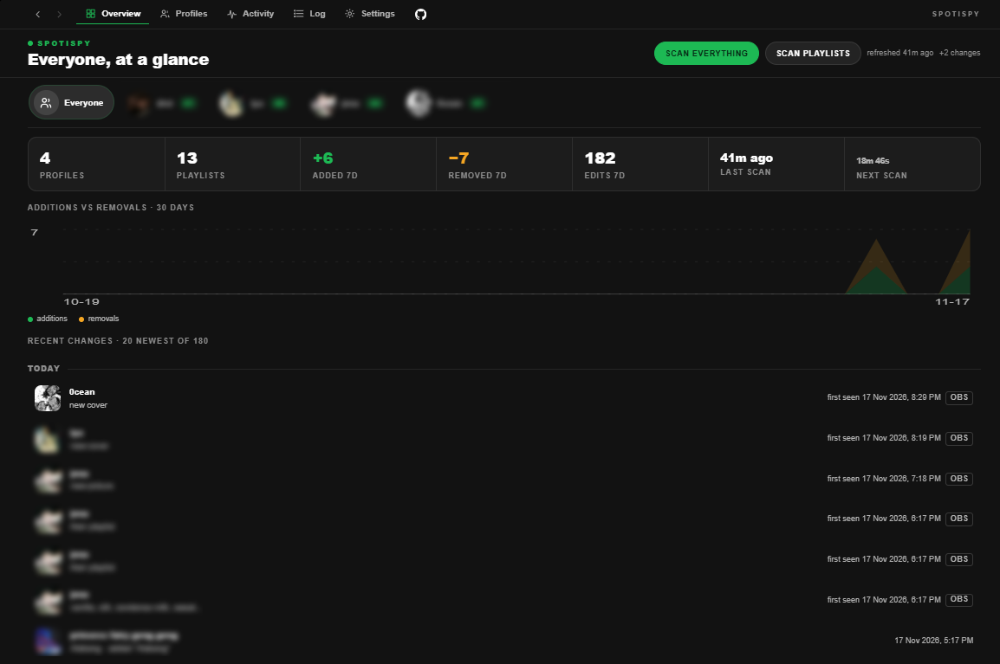
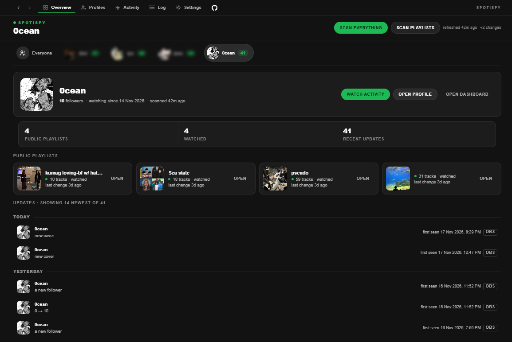
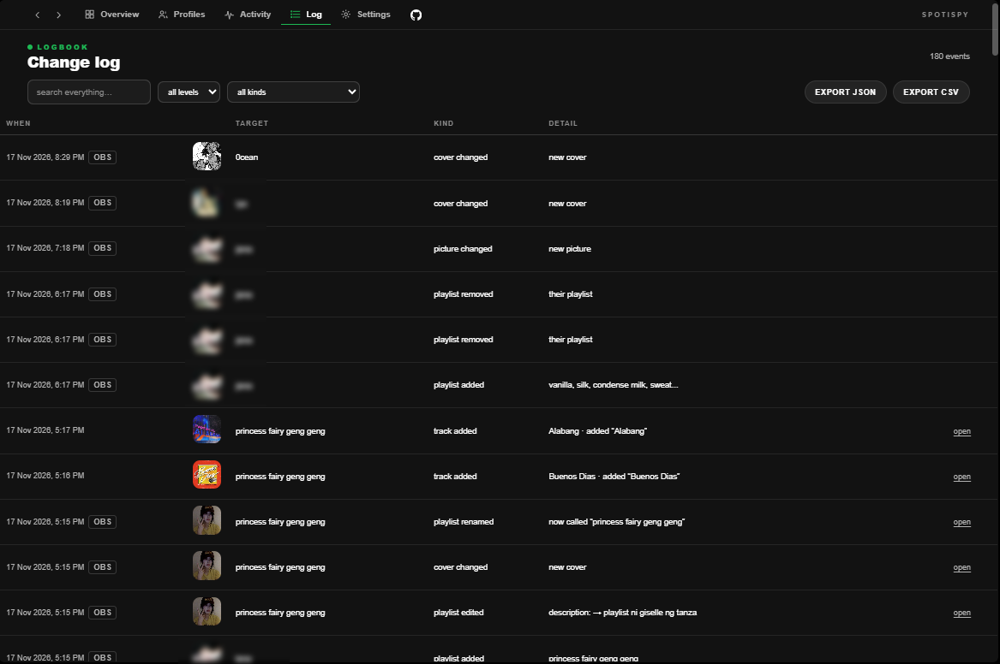
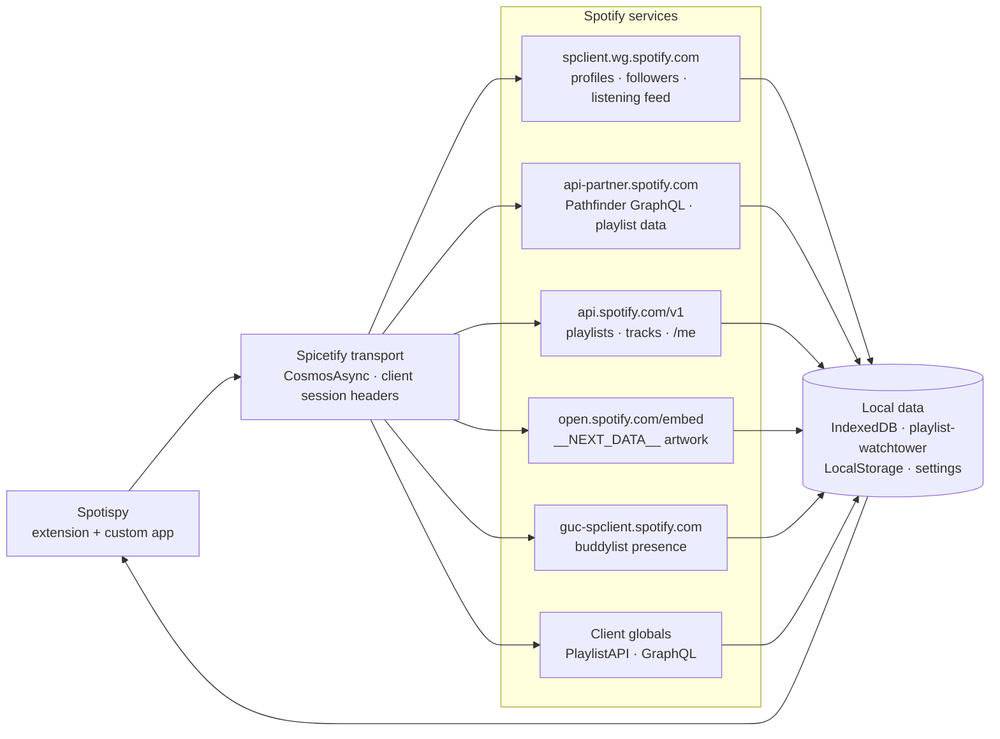

# Spotispy

[](https://github.com/illocean/spotispy/actions/workflows/ci.yml)     

Local-only Spicetify extension and custom app that watches public Spotify profiles and playlists, logs every observable change with the date it was seen, and keeps a listening-activity feed for friends who share it. Runs inside Spotify: no accounts, no cost, no data sent anywhere except exports you start.

## Screenshots

**Overview - everyone**



**Overview - one profile**



**Listening activity**


**Change log**



## How it works

The extension (`dist/spotispy.js`) owns one window-level scheduler and polls even when the app tab is closed. The custom app (`dist/CustomApps/Spotispy/`) renders from the same cache. Data lives in IndexedDB (`playlist-watchtower`) and LocalStorage. Nothing leaves the browser.

## API services

Each scan walks a source chain per target. All reads go through the running Spotify client; Spotispy carries no tokens and calls no third-party service.



Endpoints are defined in one place: `src/pwt/core/sources.js`.

## Features

- Watch public playlists and profiles from Settings (URL or `spotify:playlist:` / `spotify:user:` id) or through Spotify's right-click menu.
- First scan seeds a baseline; later scans log only changes.
- Playlist changes: track added/removed, rename, cover, description, followers, capped reads, source failures (health degrades after 3 failures).
- Profile changes: name, avatar, playlists added/removed/renamed/covered/visibility, followers, follower/following lists when reachable.
- Listening feed: plays, sessions, loop and skip flags, presence, 14-day heatmap.
- Real artwork from the client, cached locally, identicon fallback. `PWT_ART_DISABLED = true` disables it.
- Honest failures: unreachable / rate limited / not found, no fabricated status, dates or numbers. Dates Spotify does not supply are marked `obs` and stored as `observedAt`.
- No silent failure: ribbons with retry, toasts on failed actions, error boundary that keeps the nav bar alive.
- Flat, Spicetify-native dark UI.

Views: Overview, Profiles, Playlist detail, Activity, Change log, Settings.

## Install

Node.js 22+ and npm.

```powershell
npm install
npm run build
```

Review `tools/install.ps1` first: it edits your live Spotify config and runs `spicetify apply`. Then restart Spotify.

```powershell
powershell -File tools/install.ps1
```

Undo with `powershell -File tools/uninstall.ps1` (keeps an INI backup).

## Commands

```powershell
npm test          # unit tests
npm run test:ui   # UI tests in jsdom
npm run test:all  # lint + both suites
npm run build     # bundles into dist/
```

## Status and legal

Unofficial; not affiliated with Spotify. Uses undocumented internal client APIs that can break without notice and may violate Spotify's Terms of Service. Observe only what your own account can see. Not legal advice.

Development: `.github/CONTRIBUTING.md`. Security: `.github/SECURITY.md`.

MIT. See `LICENSE`.
