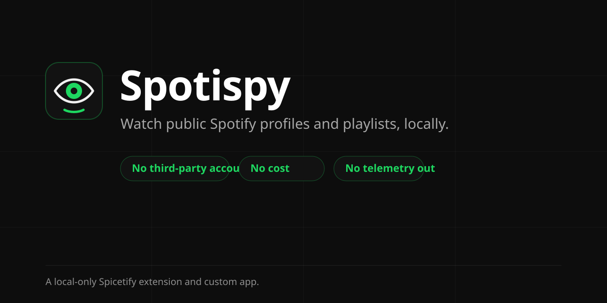

# Spotispy



[](https://github.com/illocean/spotispy/actions/workflows/ci.yml)
[](LICENSE)
[](#tests-no-spotify-needed)
[](#install)
[](#hard-constraints)

A local-only Spicetify extension + custom app that watches other users' public
Spotify profiles and playlists, logs every observable change with the date it was seen,
and keeps a listening-activity feed for friends who share it — all inside Spotify, no
third-party accounts, no cost.

**Status:** builds; unit suite (122) passes; UI suite (30) passes in jsdom against a
synthetic Spotify fixture. See "Install" to apply it to your own Spotify.

**Honest network reporting:** every failed Web API request is classified for what it
actually was. A host that cannot be reached is reported as *unreachable* (the renderer's
`Failed to fetch`), never as a rate limit; a genuine 429 is still reported as one. The
same rule holds across the self-test, the scan path, profiles and artwork — no fabricated
status anywhere.

## Design

The UI is a flat, Spicetify-native dark interface (the current design language is a
rework of the original): one near-black surface with quiet elevated cards, 1px
hairline borders, a single green accent (`--spice-button`) used only for meaningful
actions and states, hairline-divided KPI strips, day-grouped activity feeds
(Today/Yesterday), and an `obs` chip for dates Spotify supplies no timestamp for.
No gradients, no glows, no decorative chrome. Details: `src/pwt/ui/style.css`.

**The shell.** Every route sits under one persistent navigation bar: back/forward
buttons wired to the client's history (`goBack`/`goForward`, with the v4/v5 history
APIs both handled), and one tab per view — Overview, Profiles, Activity, Log,
Settings. The current tab is marked, the buttons are disabled when the client has no
history to walk. Nothing in the app is a dead end any more: every page is reachable
from every page.

**Nothing fails silently.** A route that cannot load shows a ribbon with the reason
and a retry button; a scan that writes nothing still says what it did ("no changes",
"3 sources failed"); a view that throws is caught by an error boundary that keeps the
nav bar alive and offers a reload; every action that fails raises a toast instead of
an unhandled rejection.

**Artwork.** Every image tile uses the real Spotify picture when one exists. Artwork is resolved through the routes this client actually answers: track and album covers come from the client's own GraphQL (album-of-track cover art), watched playlists' covers ride along in the profile route's payload, profile pictures come from the profile view, and a spotify:mosaic: ref is composited as its 2x2 grid of tiles (a Spotify mosaic cover IS its tiles). Anything that resolves is cached locally under `art:<uri>` with a versioned negative cache; failure routes are re-tried on a fresh resolver version, never starving. Fallback gradient identicons only appear when Spotify truly supplies no image. See `src/pwt/core/art.js`. Setting `globalThis.PWT_ART_DISABLED = true`
force-disables fetching (tests, offline harness).

## What you get

- **Overview** — user-first dashboard: pick a watched user (avatar chips, one per
  person), see their picture, how many public playlists they have, how many are watched
  and when they were watched, and a card per playlist — cover art, track count, last
  change with date, one-click **Watch**/**Open**. The selected person's card carries a
  **Watch activity** toggle and a green **listening now** chip while the listening
  feed says they are playing. Below, their **Updates** timeline: every change that
  touched them or their playlists, led by a picture and a date. The
  **Everyone** chip switches back to the aggregate KPI strip, 30-day additions/removals
  chart and the recent-change feed, as a flat KPI strip in the app's design language.
- **Profiles** — roster of watched users with their picture, per-profile timeline
  (picture/name/playlists/follower-count changes), capability-gated follower/following
  lists with an honest "unavailable on this client" state (never a silent zero).
- **Playlist detail** — the real playlist cover, rename/cover/name-change timeline,
  per-track added/removed with album art and first-seen dates, `obs` chip when Spotify
  supplies no date, source-chain and snapshot provenance, hold-and-confirm guard against
  false mass-removals.
- **Activity** — live strip of friends currently playing (their picture + the track's
  art), sessions with duration/track-count/loop/skip flags and the date they started,
  presence bar (online vs out of view) per day, 14-day listening heatmap, top contexts,
  and a search box that filters people and tracks in place.
- **Change log** — global filterable table with pictures, human labels and dates,
  JSON/CSV export.
- **Settings** — poll interval (default 60 min), activity cadence (default 60 s, adaptive
  10 s while a friend is playing), all notification toggles, watch-list management with
  covers, export and purge-all/purge-activity.
- **Diagnostics** — the app watching itself: one button runs a self-test over the
  database, the settings storage, the watch list, the track cache, the scheduler, the
  Spicetify client session, the storage quota and the live client API; every check is
  timed and reported as ok/fail. The panel also lists the slowest operations and the
  last captured errors, and "Copy report" puts the whole JSON on your clipboard.

## Hard constraints honoured

- **Local only.** Storage is the browser's IndexedDB (`playlist-watchtower` — the
  historical name, kept so existing data survives) plus `LocalStorage` for settings.
  Nothing is sent anywhere except the exports you initiate.
- **Personal data.** It observes only what the account can already see; it never follows
  or unfollows anyone and never plays anything for you.
- **Honesty.** Dates Spotify does not supply are rendered as "first seen …" with an `obs`
  chip and stored as `observedAt` separately from `sourceDate`. Follower/following lists
  report ok / degraded / unavailable instead of pretending.

## Install

```powershell
node tools/build.js        # writes dist/ (never touches the live install)
# review tools/install.ps1, then:
powershell -File tools/install.ps1
```

The installer also removes the pre-rename copies (`playlist-watchtower.js` and
`CustomApps/PlaylistWatchtower`) and keeps every other extension you have installed.

Undo everything:

```powershell
powershell -File tools/uninstall.ps1
```

The extension (`spotispy.js`) runs at Spotify start and keeps polling even with the
app tab closed; the custom app (`Spotispy`) is the sidebar entry and renders from the
shared cache.

After applying, restart Spotify and look for **Spotispy** in the sidebar. Add a
profile or a playlist from Settings, or right-click one and pick a **Watch …** entry.

If something looks wrong, open **Settings → Diagnostics → Run self-test**: it tells you
which layer is broken (client session, database, endpoints) in one click.

## Tests (no Spotify needed)

```powershell
npm install          # once: jsdom + fake-indexeddb + react for the UI suite
npm test             # 111 unit tests: diffs, sessions, view models, telemetry, art, boot,
                     # source chain (error bodies, truncation caps, failure-path merging)
npm run test:ui      # 30 UI tests: every route rendered in jsdom from a fixture
npm run test:all     # both
npm run build        # dist/spotispy.js + dist/CustomApps/Spotispy/
```

The UI suite loads the real sources into a jsdom window, stubs the Spotify client
(`CosmosAsync` answered from memory, no network), seeds synthetic profiles, playlists,
tracks, covers and art, runs real scans, and then asserts on the rendered HTML: images
present, dates present, no literal `undefined`, the diagnostics panel alive, and the
built bundle booting as a custom app. Screenshots of the same fixture can be produced
with headless Chrome.

Known risk: images load as CSS background layers from Spotify's image CDN
(`i.scdn.co`). If a Spotify build blocks those hosts, every tile falls back to its
gradient — the Diagnostics panel still reports which layer is broken, but the
pictures stay blank until the policy allows them. Track and album covers fetched
through the client's own GraphQL are unaffected by `connect-src` rules that block
plain XHR to `api.spotify.com`, `api-partner.spotify.com` and `open.spotify.com`;
on builds where those hosts are blocked, the Web API and embed sources fail with
"no response from the endpoint" and playlist track listings stay unavailable until
the client re-exposes a contents route. Names and covers still fill in from the
profile route, and the Overview names each failing source.

## Layout

```
src/
  pwt/events.js          event catalogue + change-row builder
  pwt/diff.js            pure diffs (multiset tracks, sets, scalars, shrink guard, plan)
  pwt/session.js         pure listening-"session" / presence builder
  pwt/boot.js            the ONE scheduler: window-level singleton, shared by the
                         extension and the app bundle (both run in the same window)
  pwt/core/              db (IndexedDB schema), store (atomic commit, log cap), sources
                         (all endpoints in one place), net (dedupe/backoff/pool), config,
                         telemetry (self-observation), notify, playlists, profiles,
                         activity, scheduler, export, art (embed-page artwork fetch
                         + cache)
  pwt/ui/                React views (h/createElement, no JSX toolchain)
                         App.js = the shell: nav bar, failure ribbons, error boundary
  pwt/app.js             boot + Spicetify element factory
index.js                 app entry (`render()`); also exports the file list
tools/build.js           single-file bundles for the extension and the app
tools/install.ps1        explicit installer + config backup
tools/uninstall.ps1      removes app + extension, INI backup kept
tests/                   node:test unit suite (122)
tests/support/harness.js jsdom + fake-indexeddb harness (Spotify client stub)
tests/ui/ui.test.js      UI suite: routes rendered + the controller driven for real
tests/ui/shell.test.js   shell suite: nav bar, back/forward, ribbons, live presence
probe/                   live probes of the internal endpoints, for re-verification
dist/                    build output (gitignored)
```

## Observation model and the honest bits

- Playlist rows come from the **Web API** (`api.spotify.com/v1/playlists/{id}/tracks`),
  which your client proves works (Melior uses the same host through Cosmos). If it
  answers with a session token, added dates come supplied; if not, the embed-JSON
  fallback detects the public playlist's tracks and first-seen is reported as `obs`.
  `sp://core-playlist/*` was **removed** from the scan path on 1.3.x builds (confirmed
  by the `-1 (Resolver not found!)` error on this machine) and is now only a last-ditch
  fallback after the web API and the public embed collector.
- Profiles come from the in-client `spclient` user-profile-view bundle. Follower and
  following *lists* are undocumented and sit behind a capability probe; the UI says
  exactly that when they're unreachable.
- Listening activity comes from one `POST /listening-activity/v1/feed` per tick
  (resultLimit 100, all friends at once). A user absent for 2 ticks is marked "out of
  view" — never silently counted as stopped.
- First-time verification: after install, open **Settings → Diagnostics → Run self-test**.
  It now probes the Web API and the playlist-tracks endpoint explicitly, and any
  failure names the failing layer in a red banner on every page.
- Month of the underlying endpoints: Spotify moves them without notice. `sources.js` is
  the single file to re-point when that happens; the probes in `probe/` re-check the
  three awkward ones (feed shape, profile-view field names, GraphQL hash).

## Verified vs not

Verified here: the catalogues, the diff semantics (reorders, duplicates, 100→2 shrink
hold-and-confirm, source-switch reseed), session/loop/skip logic, atomic commits and log
cap/discard, activity normaliser + presence windows, view-model shaping, all six routes
render, force scan dedupes, the popup, extension context menus and boot, the telemetry
self-test, and the UI suite that renders every route in jsdom.

Not verified: the real Spotify UI injection (Run by you), real endpoint shapes against
your account, real hour-long stability, timing budgets in a live session, Windows toast
when Spotify is minimised (falls back to the in-app toast).

## Development

Requires Node.js 20 or newer and `npm`.

```powershell
npm install      # once: jsdom + fake-indexeddb + react for the UI suite
npm test         # unit suite (122)
npm run test:ui  # UI suite in jsdom (30)
npm run test:all # both suites
npm run build    # writes dist/ (never touches the live install)
```

`dist/` is gitignored build output; never edit it by hand. `index.js` exports the
`FILES` list that `tools/build.js` derives both bundles from — add new source files
there. The IndexedDB store name (`playlist-watchtower`) and the scheduler singleton
(`src/pwt/boot.js`) are load-bearing; rename neither. See `AGENTS.md` for the full
architecture map and invariants.

## Contributing

Contributions are welcome. Please read [CONTRIBUTING.md](.github/CONTRIBUTING.md) and
the [Code of Conduct](.github/CODE_OF_CONDUCT.md). For security issues, follow
[SECURITY.md](.github/SECURITY.md) instead of opening a public issue.

## License

[MIT](LICENSE) — see [package.json](package.json) (`"license": "MIT"`).
