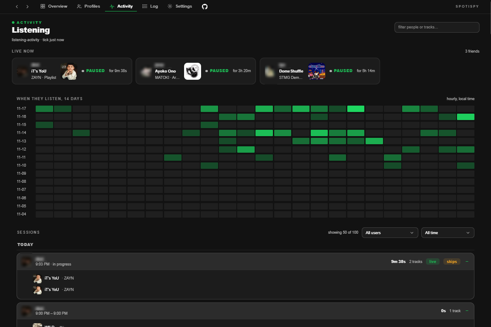
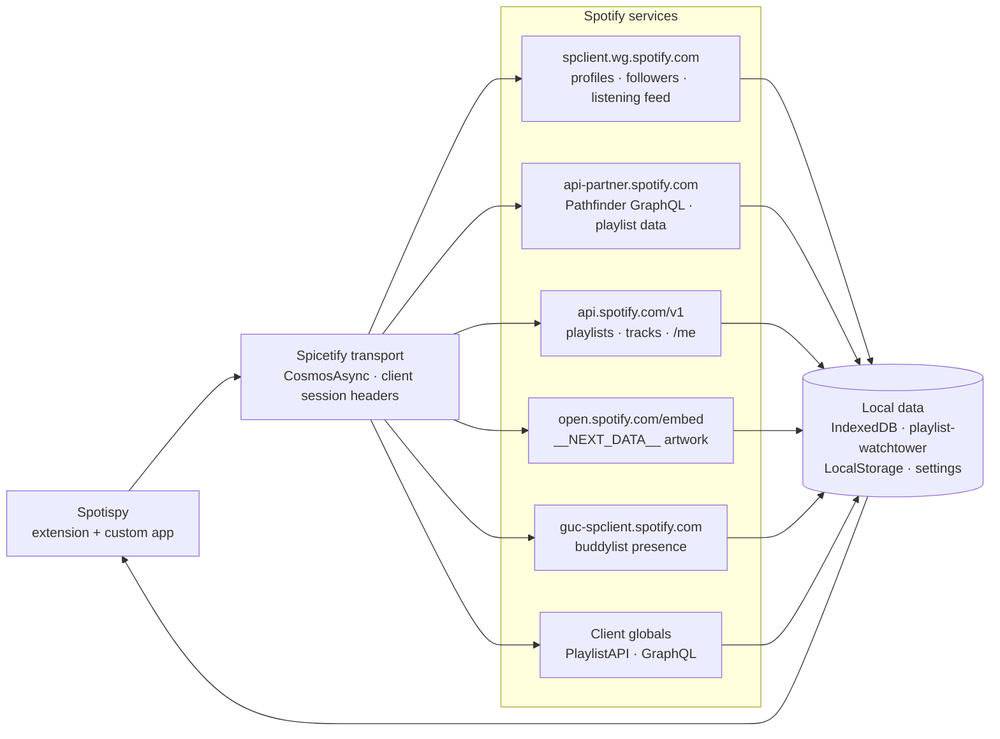

# Spotispy

[](https://github.com/illocean/spotispy/actions/workflows/ci.yml)     

A local-only Spicetify extension and custom app that watches public Spotify profiles and playlists, logs every observable change with the date it was seen, and keeps a listening-activity feed for friends who share it.

Runs inside the Spotify client. No third-party accounts. No cost. Nothing leaves your browser profile except exports you initiate.

## Screenshots

**Overview — everyone at a glance**


**Overview — one profile**


**Listening activity**



**Change log**


## Status and legal

Spotispy is an unofficial, open-source project. It is not affiliated with, endorsed by, or sponsored by Spotify AB. "Spotify" is a trademark of Spotify AB.

It works through Spicetify and Spotify's internal, undocumented client APIs (`spclient.wg.spotify.com`, `api-partner.spotify.com`, `guc-spclient.spotify.com`, the client's session and persisted-query hashes). Those endpoints are unsupported, can change or break without notice, and using them may violate Spotify's Terms of Service. Spotify may rate-limit, disable, or restrict accounts or clients that use them.

Use it at your own risk, and only to observe what your own account can already see. Do not use it to stalk, harass, or build profiles of people. This note is not legal advice.

## How it works

Two artifacts from one source tree. Both share the same window-level singleton scheduler (`src/pwt/boot.js`). Whoever boots first creates the scheduler; the other reuses it. No double-armed polling.

| Artifact | File | Job |
| --- | --- | --- |
| Extension | `dist/spotispy.js` | Runs at Spotify start. Owns the scheduler, polls even when the app tab is closed, registers the right-click context menus. |
| Custom app | `dist/CustomApps/Spotispy/` | The sidebar entry. Renders from the shared local cache. |

Data lives in the browser's IndexedDB (database `playlist-watchtower`, kept so existing local data survives renames) and in LocalStorage for settings.

A scan runs on a fixed cadence (default 60 min) through a source chain per target. A failed source writes nothing and is reported as what it is: unreachable, rate limited, not found. A scan that writes nothing still says what it did.

## API services

Every read goes through the running Spotify client. Spotispy carries no tokens of its own and calls no third-party service.



All endpoints are defined in one place: `src/pwt/core/sources.js`.

## Features

### 👀 Watching

- 🔎 Watch any public playlist or user profile.
- ➕ Add from Settings (paste a URL or a `spotify:playlist:` / `spotify:user:` id), or right-click in Spotify and pick a Watch entry.
- 🧭 Each watched item records its state at scan time. The first scan seeds a baseline; later scans log only what changed.

### 🔔 Change detection

Per playlist:

- ➕ Track added.
- ➖ Track removed.
- ✏️ Playlist renamed.
- 🖼️ Playlist cover changed.
- 📝 Playlist description changed.
- 👥 Follower count changed.
- ✂️ Track list truncated by a source (the row is marked capped; removals are not proven from a capped read).
- ⚠️ Source failed (health degrades after 3 consecutive failures, then recovers on a clean scan).

Per profile:

- 🏷️ Display name changed.
- 🖼️ Avatar changed.
- 📥 Playlist appeared (new playlist on the profile).
- 📤 Playlist disappeared (departed, renamed away, or made private; resolved by id).
- ✏️ Playlist renamed or cover changed, even for playlists you do not watch directly.
- 🔒 Playlist visibility changed (public <-> private).
- 👥 Follower count changed.
- 👤 Follower appeared or disappeared (when the follower/following list is reachable on this client).

Listening activity (friends who share it):

- ▶️ Play events.
- ⏱️ Session start and end.
- 🔁 Loop and skip flags.
- 🟢 Online / hidden transitions.
- 📊 14-day heatmap of presence.

### 📋 What the change log records

Every logged change is one row, whatever produced it:

```
{ ts, observedAt, sourceDate?, level, target, kind, title, detail, extra? }
```

`ts` is the sort key. `sourceDate` is set only when Spotify itself supplied a date; otherwise the row is observation-only and the UI shows the `obs` chip and stores the value as `observedAt`. `sourceDate` and `observedAt` are never mixed.

### ✅ Honest failure reporting

Spotify's client answers some requests with a resolved error body that carries a bogus status. Spotispy classifies every failure by what actually happened.

- 🌐 `Failed to fetch` (flat or nested): transport failure. Reported as unreachable, no response. Code `network`. No rate backoff.
- ⏳ Genuine `429`: reported as rate limited. Code `rate`. Backoff engages.
- 🔍 `404` or a removed resolver: reported as not found. Code `notfound`. Negative cache for 6 h.
- ✔️ Real payload: parsed normally.

No fabricated status anywhere: not in the self-test, the scan path, profiles, or artwork.

### 🎨 Artwork

Every tile uses the real Spotify picture when one exists. The artwork layer resolves covers through the routes the client actually answers and caches them locally under `art:<uri>`.

- 🎵 Client GraphQL for track album-of-track cover.
- 👤 Profile view payload (playlist covers ride along).
- 🌐 Embed page `__NEXT_DATA__`.
- 🧩 Mosaic composites, resolved as their 2x2 tiles.
- 🖼️ Nothing resolves: a gradient identicon fallback. No broken image icons.

The sweep after each scan is best effort and never blocks a scan. `PWT_ART_DISABLED = true` force-disables it (tests, offline).

### 🖤 Design

Flat, Spicetify-native dark interface. One near-black surface, quiet elevated cards, 1px hairline borders, a single green accent (`--spice-button`), no gradients or glows.

Nothing fails silently:

- 🚧 A route that cannot load shows a failure ribbon with the reason and a retry button.
- 🔔 A failing action raises a toast.
- 🛡️ A view that throws is caught by an error boundary that keeps the nav bar alive and offers reload / go-to-overview.
- 💥 A crash at boot or mount renders a visible crash screen with the message, stack, and a hint to run the self-test.

## Views

| View | What it shows |
| --- | --- |
| 📊 Overview | Per-user dashboard: avatar chips, watched playlists, last change per playlist, Watch/Open actions, listening-now chip, Updates timeline, 30-day chart, and an honest scan summary line. |
| 👥 Profiles | Roster with per-profile timeline (picture, name, playlists, followers) and honest follower/following states. |
| 🎵 Playlist detail | Real cover, rename/cover timeline, per-track added/removed with art, `obs` chip, source provenance, health badge, hold-and-confirm guard against mass removals. |
| 📈 Activity | Live "playing now" hero and strip, sessions grouped by local day with loop/skip flags, presence bars, a 14-day heatmap, and in-place search. |
| 📜 Change log | Global filterable table with pictures and dates. Search, level filter, kind filter. Export JSON or CSV. |
| ⚙️ Settings | Poll and activity cadence, notifications, watch-list management, data counts, export, purge, and Diagnostics. |

## Settings

All settings are local. Defaults are applied on first load and saved to LocalStorage on change.

### Polling

| Setting | Default | Options | What it controls |
| --- | --- | --- | --- |
| Change scan interval (`pollMs`) | `3600000` (60 min) | `900000` (15 min), `1800000` (30 min), `3600000` (60 min), `10800000` (180 min) | How often the scheduler runs a full scan (profiles, then playlists). A manual scan is never blocked by this interval. |
| Activity interval (`activityMs`) | `5000` (5 s) | `2000` (2 s), `5000` (5 s), `10000` (10 s), `30000` (30 s), `60000` (60 s), `120000` (120 s), `0` (off) | How often the listening-activity feed is polled. One request covers every watched friend each tick. |
| Boost interval (`activityBoostMs`) | `2000` (2 s) | `1000` (1 s), `2000` (2 s), `5000` (5 s), `10000` (10 s), `30000` (30 s) | The faster cadence used while `activityBoost` is on and at least one friend is listening. The error back-off always wins over it. |
| Activity retention (`retainDays`) | `90` (90 days) | `0` (keep forever), `30`, `90`, `180`, `365` | How much activity history to keep. Older rows are deleted after a scan, at most once a day. |

Activity has an adaptive cadence: when friends are online and `activityBoost` is on, it ticks faster (`activityBoostMs`, default 2 s). When the feed returns an error, the timer is re-armed at no faster than 3 min (`ACTIVITY_ERROR_BACKOFF_MS`).

A manual scan that runs less than 5 min after the last full scan is skipped unless forced.

### Notifications

| Setting | Default | What it controls |
| --- | --- | --- |
| `notifyToast` | `true` | In-app toast after a scan (results and errors). Always available. |
| `notifyOs` | `true` | OS notification when the Spotify window is not focused and the renderer exposes a working `Notification`. Falls back to a toast when unavailable. |
| `notifyAdditions` | `true` | Toast on track additions. |
| `notifyRemovals` | `true` | Toast on track removals. |
| `notifyProfile` | `true` | Toast on profile-level changes (name, avatar, playlists, followers). |
| `notifyPresence` | `true` | Toast when a watched friend goes online or out of view. |
| `activityBoost` | `true` | Faster activity polls while a friend is playing (`activityBoostMs`, default 2 s). |
| `followers` | `true` | Track follower / following lists when the client allows it. Reports ok / degraded / unavailable instead of a silent zero. |

The Settings page shows whether OS notifications are supported and their current permission state on this client.

### Watch list

- Add a playlist or profile by URL or id.
- Each row shows the kind, the label, and the date you started watching it.
- Unwatch removes the row. Existing change history is not deleted by unwatching.

### Data

- Cache size (IndexedDB footprint) is shown on the page.
- Change row count and play row count are shown.
- Activity retention (`retainDays`, default 90) is enforced after a scan, at most once a day: plays, sessions and day ticks older than the window are deleted. Aggregates, change history and watches are never pruned. `0` means "keep forever"; an unlisted or negative value falls back to the default. A deletion is recorded in telemetry, never silent.
- The log is capped at `logCap` (default 10,000 change rows). Day buckets keep the totals after the log is capped.
- Export all: JSON or CSV of the change log.
- Purge activity: clears plays, sessions, day ticks, and activity state.
- Purge everything: clears every store except `meta`.

### Diagnostics

- One-click self-test over every layer: client session, database, endpoints.
- Shows checks passed, total time, uptime, and errors caught.
- Lists the slowest operations and the last errors.
- Copy report puts a plain-text report on the clipboard.

## Install

Requires Node.js 22+ and npm.

```powershell
npm install          # once: jsdom + fake-indexeddb + react for the UI suite
npm run build        # writes dist/ (never touches the live install)
```

Review `tools/install.ps1` before running it. It modifies your live Spotify config and is not part of the build.

```powershell
powershell -File tools/install.ps1
```

The installer:

- Copies `dist/spotispy.js` to `%APPDATA%\spicetify\Extensions\spotispy.js`.
- Copies `dist/CustomApps/Spotispy` to `%APPDATA%\spicetify\CustomApps\Spotispy`.
- Removes the pre-rename copies (`playlist-watchtower.js`, `CustomApps\PlaylistWatchtower`).
- Enables the extension and the custom app in `config-xpui.ini`.
- Backs up `config-xpui.ini` before any change.
- Leaves every other extension and app you have untouched.
- Runs `spicetify apply`.

After applying, restart Spotify. Open Spotispy in the sidebar, then add a profile or playlist from Settings or right-click one in Spotify and pick a Watch entry.

To undo everything:

```powershell
powershell -File tools/uninstall.ps1
```

The uninstaller removes the app and the extension, keeps an INI backup, and does not touch your other extensions.

## Tests

No Spotify needed.

```powershell
npm test             # unit suite (node --test "tests/*.test.js")
npm run test:ui      # UI suite in jsdom (node --test "tests/ui/*.test.js")
npm run test:all     # both
```

The unit suite covers diffs, sessions, view models, telemetry, art, boot, the source chain (error bodies, truncation caps, failure-path merging), and scan reporting. It does not need Spotify.

The UI suite loads the real sources into a jsdom window, stubs the Spotify client (`CosmosAsync` answered from memory, no network), seeds synthetic profiles, playlists, tracks, and covers, runs real scans, and asserts on rendered HTML (images present, dates present, no literal `undefined`, diagnostics panel alive, built bundle boots as a custom app).

The sanctioned way to boot the app in Node is `tests/support/harness.js`. Reuse it; do not hand-roll a jsdom setup.

## Layout

```
index.js                 app entry (render()); exports the FILES list for tools/build.js
src/pwt/events.js        event catalogue + change-row builder
src/pwt/diff.js          pure diffs (multiset tracks, sets, scalars, shrink guard, plan)
src/pwt/session.js       pure listening-session / presence builder
src/pwt/boot.js          the ONE scheduler (window-level singleton)
src/pwt/app.js           boot + Spicetify element factory
src/extension-main.js    extension entry: boots scheduler + registers context menus
src/pwt/core/            db (IndexedDB schema), store (atomic commit, log cap),
                         sources (all endpoints in one place), net (dedupe/backoff/pool),
                         config, telemetry (self-observation), notify, playlists,
                         profiles, activity, scheduler, export, art
src/pwt/ui/              React views (h/createElement, no JSX toolchain);
                         App.js = the shell: nav bar, failure ribbons, error boundary
tools/build.js           single-file bundles for the extension and the app
tools/install.ps1        explicit installer + config backup
tools/uninstall.ps1      removes app + extension, INI backup kept
tests/                   node:test unit suite
tests/support/harness.js jsdom + fake-indexeddb harness (Spotify client stub)
tests/ui/                UI suites: routes rendered + controller driven for real
probe/                   live probes of the internal endpoints, for re-verification
dist/                    build output (gitignored)
```

`src/pwt/core/sources.js` is the single place endpoints are defined. Spotify moves them without notice; re-point them there, not scattered across the codebase.

`probe/` re-checks the three awkward endpoints against a live client.

## Verified vs not

| Verified here | Not verified (needs your machine) |
| --- | --- |
| Diff semantics (reorders, duplicates, shrink hold-and-confirm) | Real Spotify UI injection |
| Sessions, loops, skips, presence windows | Real endpoint shapes against your account |
| Atomic commits, log cap, export | Hour-long stability in a live session |
| All routes rendered, force-scan dedupe, popup, context menus | Windows toast when Spotify is minimised |
| Telemetry self-test, UI suite in jsdom | Image-CDN policy edge cases |

## Development

See `.github/CONTRIBUTING.md` for the development setup, the architecture invariants, and the pull-request checklist. For security issues, follow `.github/SECURITY.md`.

## License

MIT. See `LICENSE`.