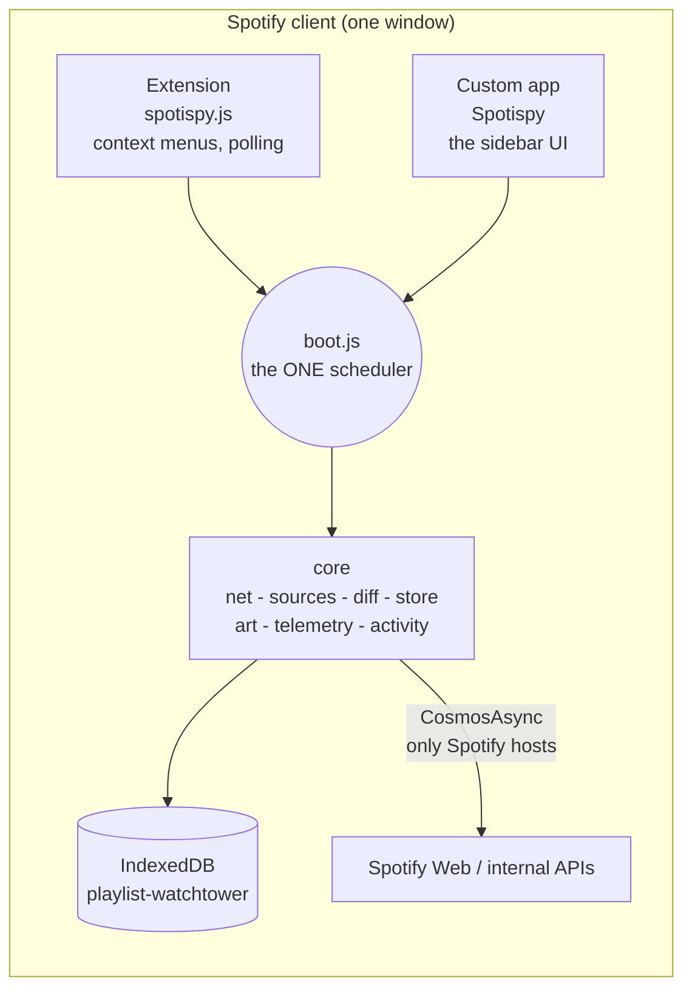
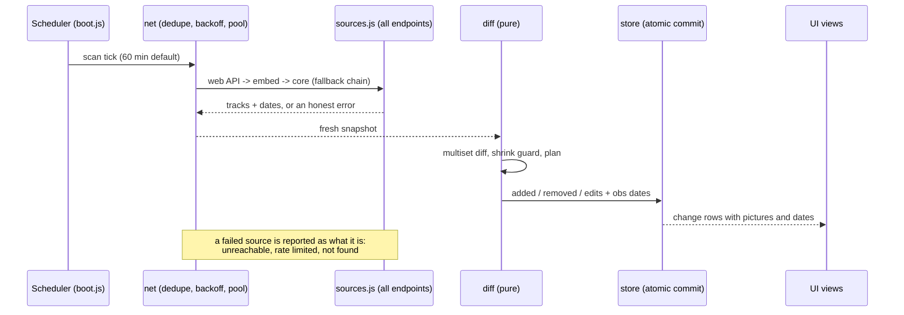
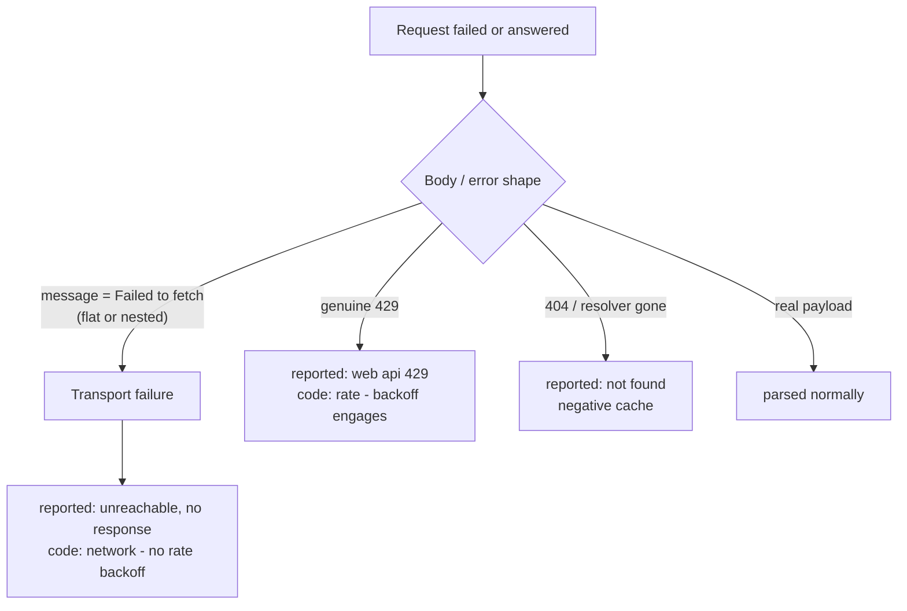
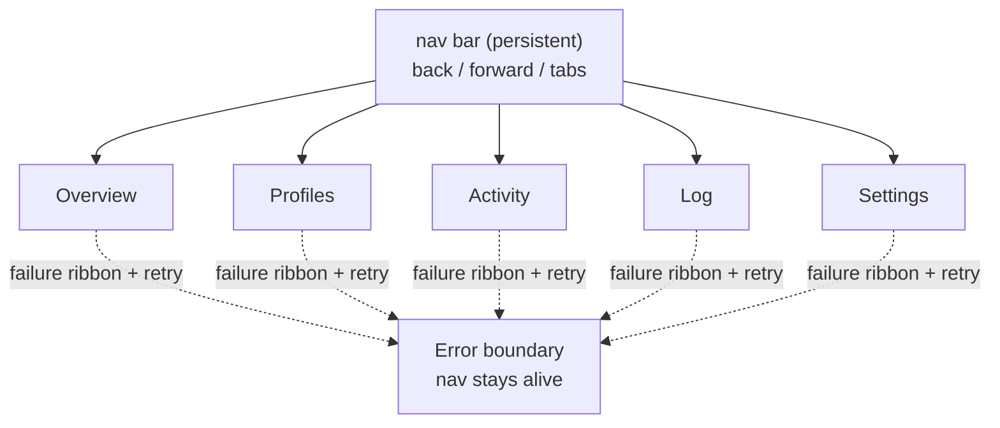
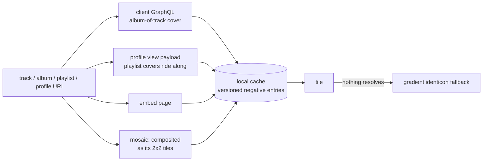
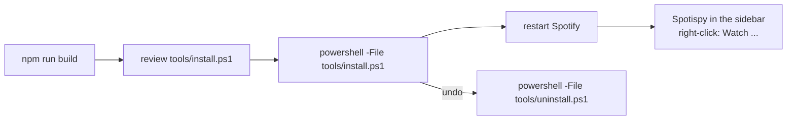
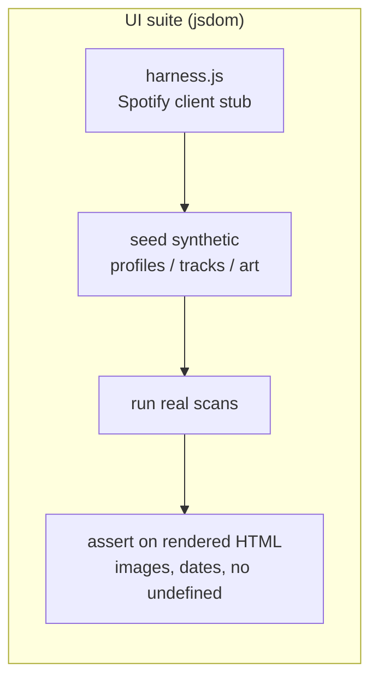

# Spotispy

[](https://github.com/illocean/spotispy/actions/workflows/ci.yml)
[](LICENSE)
[](#tests-no-spotify-needed)
[](#install)
[](#hard-constraints)

A local-only Spicetify extension + custom app that watches other users' public
Spotify profiles and playlists, logs every observable change with the date it was seen,
and keeps a listening-activity feed for friends who share it. All inside Spotify.
No third-party accounts, no cost, nothing sent anywhere.



Two artifacts, one source tree, one scheduler: the extension polls even when the app
tab is closed, the app renders from the shared cache.

## What you get

| View | What it shows |
| --- | --- |
| **Overview** | Per-user dashboard: avatar chips, watched playlists, last change per playlist, Watch/Open, a listening-now chip, and an Updates timeline. |
| **Profiles** | Roster with per-profile timeline (picture, name, playlists, followers) and honest follower/following states. |
| **Playlist detail** | Real cover, rename/cover timeline, per-track added/removed with art, `obs` chip, source provenance, hold-and-confirm guard. |
| **Activity** | Live "playing now" strip, sessions with loop/skip flags, presence bars, a 14-day heatmap, in-place search. |
| **Change log** | Global filterable table with pictures and dates, JSON/CSV export. |
| **Settings** | Poll/activity cadence, notifications, watch-list management, export, purge, and Diagnostics. |
| **Diagnostics** | One-click self-test over every layer (database, session, endpoints), slowest operations, last errors, copy report. |

## How a scan works



Every diff is pure and unit-tested; every commit to IndexedDB is atomic; the log is
capped. A scan that finds nothing still says so.

## Honest reporting

The live client reports an unreachable host as a resolved error body carrying a bogus
status. Spotispy classifies every failure by what actually happened:



No fabricated status anywhere: not in the self-test, the scan path, profiles, or
artwork. Dates Spotify does not supply render as "first seen" with an `obs` chip and
are stored as `observedAt`, never mixed with a real `sourceDate`.

## Design

Flat, Spicetify-native dark interface: one near-black surface, quiet elevated cards,
1px hairline borders, a single green accent (`--spice-button`), no gradients or glows.



Nothing fails silently: a route that cannot load shows a ribbon with the reason and a
retry button; a failing action raises a toast; a view that throws is caught by an
error boundary that keeps the nav bar alive.

## Artwork

Every tile uses the real Spotify picture when one exists, resolved through the routes
this client actually answers, and cached locally under `art:<uri>`:



Set `globalThis.PWT_ART_DISABLED = true` to force-disable fetching (tests, offline).

## Hard constraints

| Constraint | What it means |
| --- | --- |
| Local only | Storage is IndexedDB (`playlist-watchtower`) + LocalStorage. Nothing is sent anywhere except exports you initiate. |
| Personal data | Observes only what your account can already see. Never follows, unfollows, or plays anything. |
| Honesty | No fabricated statuses, dates, or numbers. Degraded sources say degraded. |

## Install



```powershell
node tools/build.js        # writes dist/ (never touches the live install)
# review tools/install.ps1, then:
powershell -File tools/install.ps1
```

The installer removes the pre-rename copies and keeps every other extension you have.
After applying, restart Spotify, open **Spotispy** in the sidebar, and add a profile or
playlist from Settings, or right-click one and pick a **Watch ...** entry.

If something looks wrong: **Settings -> Diagnostics -> Run self-test** names the broken
layer (client session, database, endpoints) in one click.

## Tests (no Spotify needed)

```powershell
npm install          # once: jsdom + fake-indexeddb + react for the UI suite
npm test             # 122 unit tests
npm run test:ui      # 30 UI tests
npm run test:all     # both
npm run build        # dist/spotispy.js + dist/CustomApps/Spotispy/
```



The UI suite loads the real sources into a jsdom window, answers `CosmosAsync` from
memory (no network), and drives the controller through the real UI. The sanctioned way
to boot the app in Node is `tests/support/harness.js` — reuse it.

## Layout

```
src/pwt/
  boot.js               the ONE scheduler (window-level singleton)
  diff.js               pure diffs (multiset, shrink guard, plan)
  session.js            pure listening-session / presence builder
  events.js             event catalogue + change-row builder
  core/                 db, store, sources (all endpoints), net, config,
                        telemetry, notify, playlists, profiles, activity,
                        scheduler, export, art
  ui/                   React views (h/createElement, no JSX toolchain)
index.js                app entry; exports the FILES list for tools/build.js
tools/build.js          single-file bundles for extension + app
tools/install.ps1       explicit installer + config backup
tests/                  node:test suites + jsdom harness
probe/                  live probes of the internal endpoints
```

Spotify moves endpoints without notice; `sources.js` is the single file to re-point,
and `probe/` re-checks the three awkward ones.

## Verified vs not

| Verified here | Not verified (needs your machine) |
| --- | --- |
| Diff semantics (reorders, duplicates, shrink hold-and-confirm) | Real Spotify UI injection |
| Sessions, loops, skips, presence windows | Real endpoint shapes against your account |
| Atomic commits, log cap, export | Hour-long stability in a live session |
| All routes rendered, force-scan dedupe, popup, context menus | Windows toast when Spotify is minimised |
| Telemetry self-test, UI suite in jsdom | Image-CDN policy edge cases |

## Development

Requires Node.js 22+ and `npm`. See [CONTRIBUTING.md](.github/CONTRIBUTING.md) and
[AGENTS.md](AGENTS.md) for the architecture map and invariants. For security issues,
follow [SECURITY.md](.github/SECURITY.md).

## License

[MIT](LICENSE)
